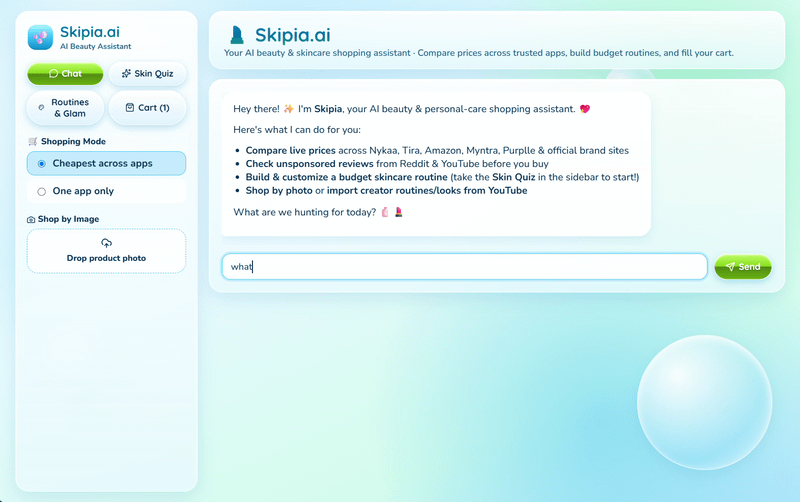
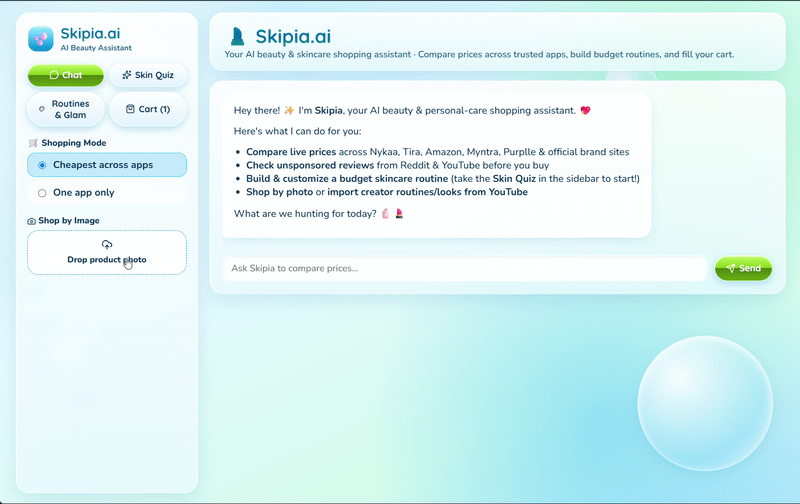
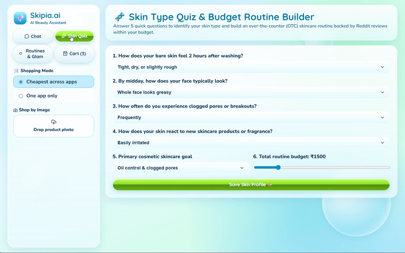
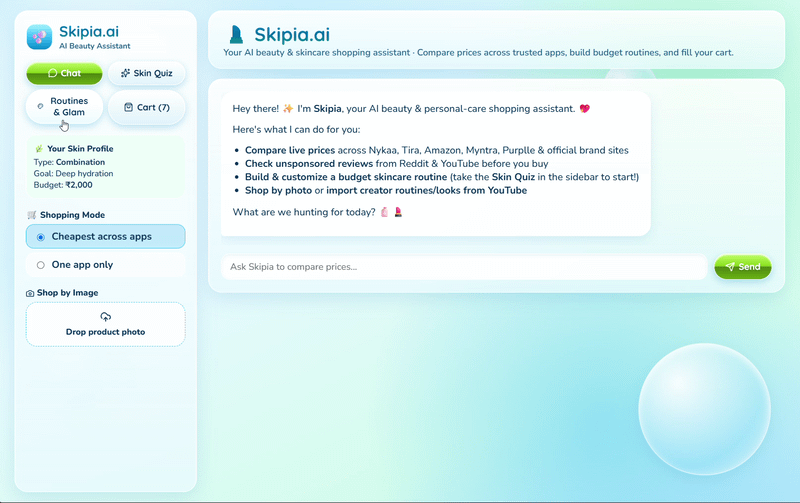
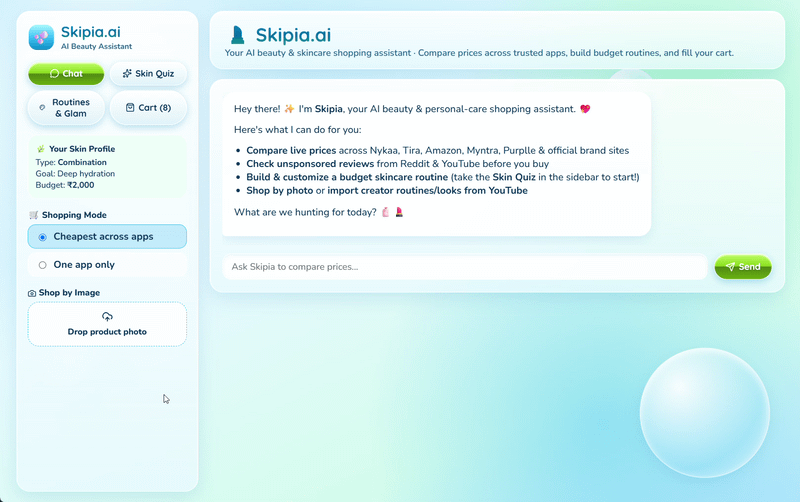

# Skipia.ai - AI Beauty & Skincare Shopping Assistant

Skipia.ai is a full-stack, Agentic AI application designed for the Indian over-the-counter (OTC) beauty market. It utilizes a LangChain ReAct agent to autonomously orchestrate price comparisons, review aggregation, and routine building across major platforms like Amazon, Nykaa, Tira, and Purplle.

## Architecture & Tech Stack

- **Frontend:** React (Vite), Frutiger Aero-inspired UI
- **Backend API:** FastAPI (Python)
- **AI Orchestration:** LangChain, Groq (Llama 3), Gemini Vision
- **Web Scraping/Search:** SerpApi (Google Shopping, Google Lens)
- **Database:** SQLite (WAL mode)

### Agentic Workflow
The system routes user inputs through a domain-guardrail LLM before invoking a ReAct agent. The agent selects from specialized tools (e.g., `compare_prices`, `get_reddit_reviews`, `compare_routine_prices`) to fetch live data, parse it, and present it to the frontend.

---

## Features

### 1. Live Multi-Store Price Comparison
The agent scrapes and normalizes product data across multiple Indian retailers, fetching the lowest price and direct purchase links.


### 2. Aggregated Product Reviews
Fetches unsponsored product reviews and discussions from Reddit and YouTube, filtering out paid promotions and affiliate links.



### 3. Visual Search (Image Recognition)
Users can upload a photo of a product. The backend uses Google Lens and Gemini Vision to identify the exact product and automatically triggers a price comparison.



### 4. Skin Type Quiz & Budget Routine Builder
Evaluates user skin profiles via a deterministic quiz and uses parallel API calls to build a budget-friendly, 3-step skincare routine backed by live pricing.



### 5. Video Product Extraction (Routines & Glam)
Allows users to paste a YouTube link or caption. The backend uses an LLM to extract specific products mentioned in the video's description or transcript, bypassing social media noise and platform links.



### 6. Multi-Store Shopping Cart
Allows users to add products with specific size and shade variants. The cart supports direct handoff to Amazon's 1-click bulk add feature.



---

## Local Setup Instructions

### Prerequisites
- Python 3.10+
- Node.js 18+
- API Keys: SerpApi, Groq, Gemini, YouTube Data API

### 1. Backend Setup

```bash
# Clone the repository
git clone https://github.com/M-R-777/Beauty_Agent.git

# Move into the directory
cd Beauty_Agent

# Create and activate virtual environment
python -m venv venv
source venv/bin/activate  # On Windows: venv\Scripts\activate

# Install dependencies
pip install -r requirements.txt